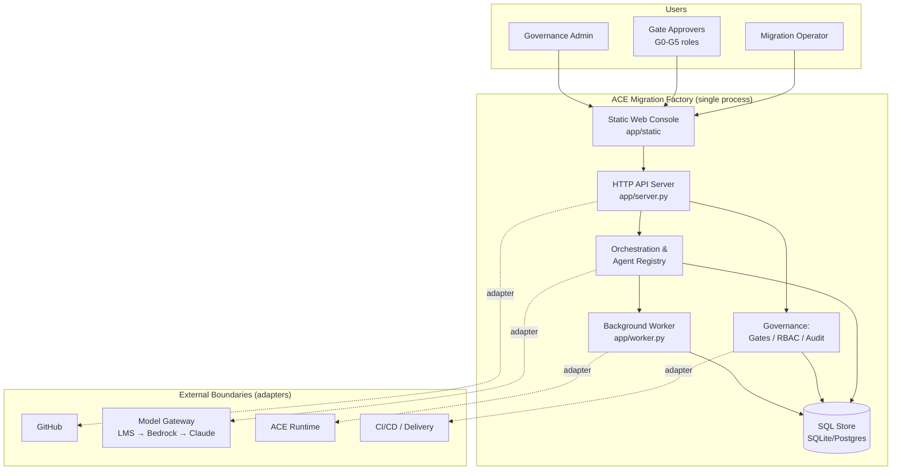
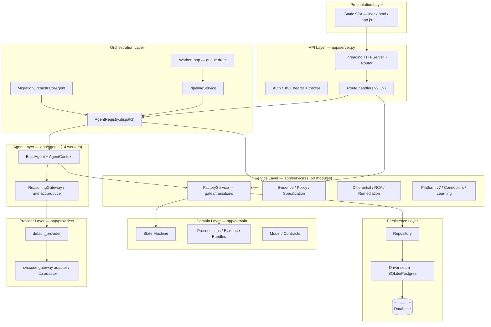
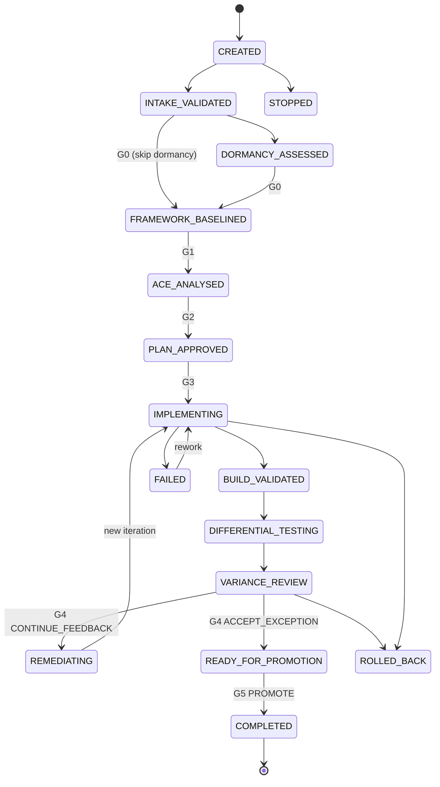
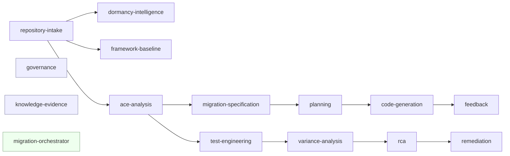
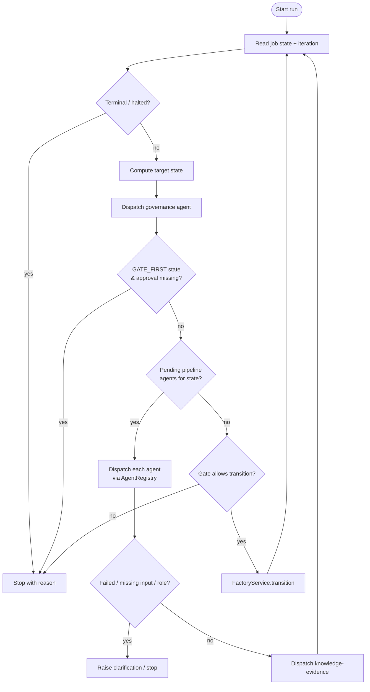
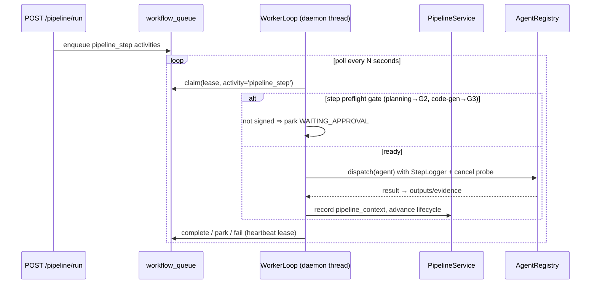
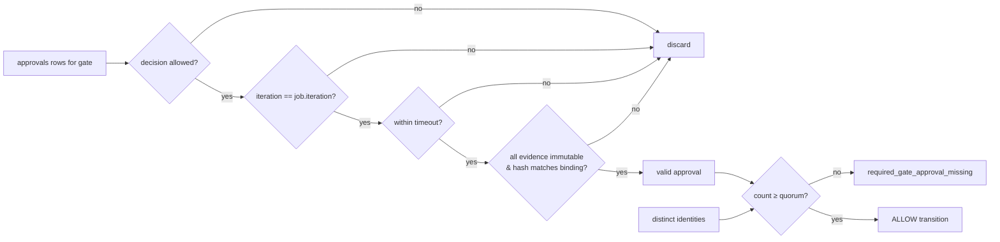
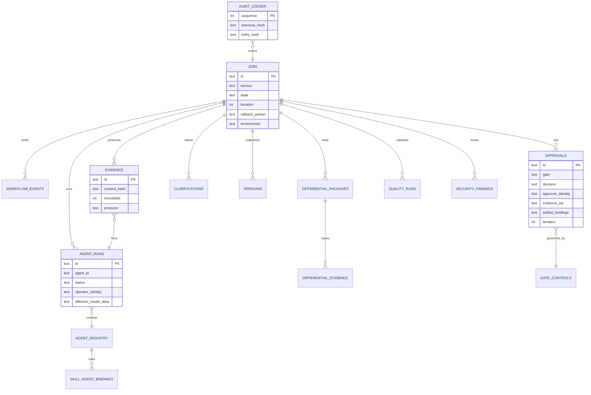
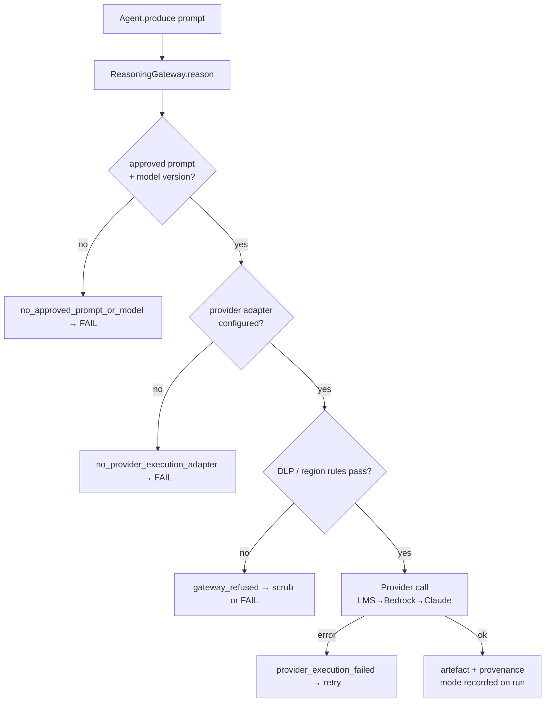
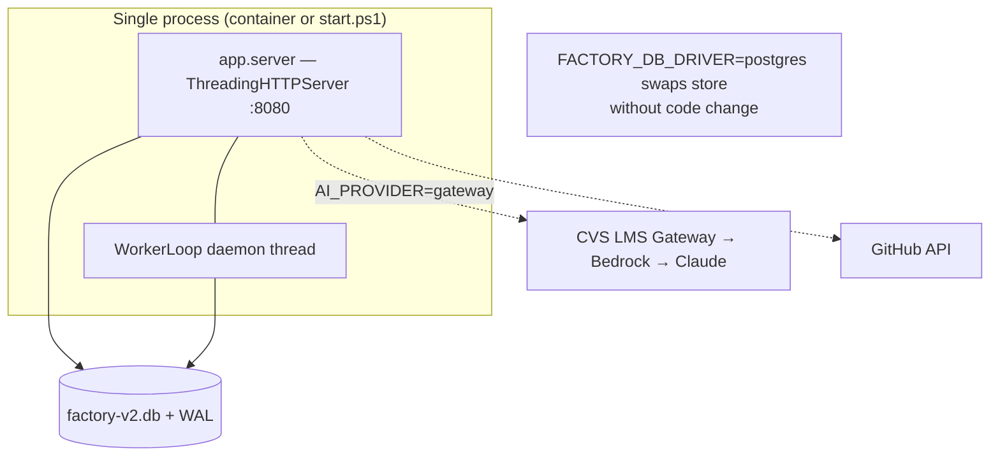

# ACE Migration Factory — Design Document (HLD + LLD)

> Governed, agentic IBM ACE → Spring Boot migration platform.
> Reference implementation: Python standard-library HTTP server, pluggable SQL persistence, 14 governed agents, a 6-gate (G0–G5) approval lifecycle, and a model gateway seam.

---

## 1. Purpose & Scope

The ACE Migration Factory automates the migration of IBM App Connect Enterprise (IBM Integration Bus / IIB) integration flows to Spring Boot microservices **under enterprise governance**. Every state change is gated, every artefact is hashed and bound to the approval that authorised it, and every action is recorded in an append-only audit ledger.

The system is deliberately a **governed orchestration layer, not a simulator**: identity, Git, CI/CD, object storage, the ACE runtime, the model gateway and scanners are *boundaries* (adapters), not mock implementations. When a boundary (e.g. a model provider) is unavailable, the pipeline **stops** rather than silently producing an unverified result.

### In scope
- Repository intake, dormancy assessment, ACE semantic analysis, framework baselining
- Migration specification (schema-validated YAML), planning, Spring code generation
- Build/test execution, differential testing, variance analysis, RCA, remediation
- 6-gate approval governance (G0–G5) with quorum, iteration-binding and evidence preconditions
- Role-based access control, model-gateway routing, append-only audit trail

### Out of scope (boundaries)
Production orchestration connectors, real ACE runtime, real CI/CD, secret storage backends — all represented as logical references / adapter seams.

---

## 2. High-Level Design (HLD)

### 2.1 System Context



### 2.2 Layered Architecture



### 2.3 Core Design Principles

| Principle | Mechanism |
|-----------|-----------|
| No unsigned promotion | Every gated transition re-checks quorum, iteration & evidence bindings in `FactoryService.transition` |
| Immutable evidence | SHA-256 `content_hash`; approvals bind to `(evidence_id, hash)`; a changed hash invalidates the approval |
| Contract governance | `config/agent-catalogue.v1.json` is the source of truth; a changed contract hash blocks startup (`agent_contract_drift`) |
| Fail-closed model path | No provider ⇒ `ArtefactUnavailable` ⇒ agent FAILS. The factory never silently computes an unverified artefact |
| RBAC is never relaxed for autonomy | Autonomous runs act as a service principal and are checked against each agent's `required_role` |
| Append-only audit | `audit_ledger` is a hash-chained ledger (`previous_hash` → `entry_hash`) |

---

## 3. Migration Lifecycle & Gates

### 3.1 State Machine (`app/domain/state_machine.py`)



> `WAITING_G0…WAITING_G5` are explicit holding states. When an agent cannot proceed because a gate is unsigned, the job parks in a `WAITING_Gx` state; an approval that satisfies quorum auto-advances it (`FactoryService.approve` → `_WAITING_TARGETS`).

### 3.2 Gate Map (`FactoryService.GATE_TRANSITIONS`)

| Gate | Transition | Approver Role | Allowed Decisions |
|------|-----------|---------------|-------------------|
| G0 | DORMANCY/INTAKE → FRAMEWORK_BASELINED | SERVICE_OWNER | PROCEED / STOP / CLARIFY |
| G1 | FRAMEWORK_BASELINED → ACE_ANALYSED | JAVA_ARCHITECT | APPROVE / REJECT / CLARIFY |
| G2 | ACE_ANALYSED → PLAN_APPROVED | ACE_SME | APPROVE / REJECT / CLARIFY |
| G3 | PLAN_APPROVED → IMPLEMENTING | PRODUCT_OWNER | APPROVE / REJECT / CLARIFY |
| G4 | VARIANCE_REVIEW → REMEDIATING / READY_FOR_PROMOTION | QA_LEAD | CONTINUE_FEEDBACK / STOP / ACCEPT_EXCEPTION |
| G5 | READY_FOR_PROMOTION → COMPLETED | RELEASE_MANAGER | REPEAT / STOP / PROMOTE |

### 3.3 Evidence-Bundle Preconditions (`app/domain/preconditions.py`)

An approval says *who* agreed; the evidence bundle says *what* they agreed about. Enforced on the three high-risk transitions:

| Target State | Required Bundle |
|--------------|----------------|
| `VARIANCE_REVIEW` | differential package exists & all cases executed |
| `READY_FOR_PROMOTION` | differential executed + quality run not FAIL |
| `COMPLETED` | differential **dispositioned** + quality pass + **no OPEN HIGH security findings** + rollback pointer + version snapshot |

---

## 4. The 14 Governed Agents

### 4.1 Agent Catalogue & Dependency Graph



| Agent | Required Role | Key Outputs | Depends On |
|-------|--------------|-------------|------------|
| migration-orchestrator | ORCHESTRATOR | commands, next_state_proposal | — |
| repository-intake | REPOSITORY_INTAKE | intake_manifest, gaps | — |
| dormancy-intelligence | DORMANCY_ANALYST | classification, confidence | repository-intake |
| framework-baseline | FRAMEWORK_ANALYST | framework_template, conflicts | repository-intake |
| ace-analysis | ACE_ANALYST | analysis_document, semantic_model, ambiguities | repository-intake |
| migration-specification | SPECIFICATION_AUTHOR | migration_specification_yaml | ace-analysis |
| planning | MIGRATION_PLANNER | plan, task_graph, mapping, risk_register | migration-specification |
| code-generation | CODE_GENERATOR | source_code, tests, manifest | planning |
| feedback | FEEDBACK_ENGINEER | applied_fixes, quality_status | code-generation |
| test-engineering | TEST_ENGINEER | test_suites, execution_evidence | ace-analysis |
| variance-analysis | VARIANCE_ANALYST | variance_records, severity | test-engineering |
| rca | RCA_ANALYST | rca_hypotheses, confidence | variance-analysis |
| remediation | REMEDIATION_ENGINEER | patch_plan, code_changes, tests | rca |
| governance | GOVERNANCE_ENGINE | allow_deny_decision, evidence_requirement | — |
| knowledge-evidence | KNOWLEDGE_CURATOR | cited_context, version_lineage | — |

### 4.2 Agent Contract Enforcement (LLD)

Each worker extends `BaseAgent` and declares `AGENT_ID`, `TOOLS`, `OUTPUTS`, `PROMPT`, `SKILL`. `AgentRegistry.conformance` compares declared vs. catalogue; any extra tool/output is **drift** and refuses dispatch.

```mermaid
sequenceDiagram
    participant C as Caller (API/Orchestrator/Worker)
    participant R as AgentRegistry.dispatch
    participant Reg as agent_registry (DB)
    participant Impl as Agent impl (execute)
    participant GW as ReasoningGateway / produce
    participant Ev as EvidenceService
    participant L as audit_ledger

    C->>R: dispatch(job, agent_id, roles, identity, params)
    R->>Reg: contract(agent_id, version) — APPROVED?
    R->>R: conformance() — no tool/output drift
    R->>R: dependency_status() — prereqs COMPLETED
    R->>R: resolve LLM alias (fail-closed vs model_registry)
    R->>Reg: start() → agent_runs row (RUNNING, owner)
    R->>Impl: execute(context)
    Impl->>GW: produce(prompt, payload)
    alt provider available
        GW-->>Impl: model artefact + provenance
    else no provider / refused
        GW-->>Impl: ArtefactUnavailable → FAIL
    end
    Impl-->>R: AgentResult(outputs, evidence, clarifications)
    R->>R: verify outputs ⊆ contract; tool caps for evidence/clarification
    R->>Ev: register evidence (hash = artefact content_hash)
    R->>Reg: complete() → run COMPLETED/FAILED/CANCELLED
    R->>L: audit + learning records
    R-->>C: {run_id, status, outputs, evidence}
```

---

## 5. Orchestration & Execution Flow

### 5.1 Autonomous Orchestration Loop (`MigrationOrchestratorAgent.execute`)



Guards: a step budget (`max_steps`, default 24), one visit per `(iteration, state, agent)`, and halt on a PAUSED checkpoint or a cancel-requested queue row. Governance is never bypassed — transition always runs `_transition_policy` + `evidence_bundle`.

### 5.2 Pipeline Worker Queue Model



The worker decouples execution from the request lifetime: a pipeline keeps running after the browser tab closes. Cancellation is cooperative — checkpoints sit *between* model calls.

---

## 6. Low-Level Design (LLD)

### 6.1 Module Map

| Path | Responsibility |
|------|----------------|
| `app/server.py` | `ThreadingHTTPServer`, routing (`do_GET/POST/PUT/DELETE`), JWT auth, throttle, static files, API v2–v7 |
| `app/service.py` | `FactoryService` — job creation, gated transitions, approvals, quorum, iteration binding, rollback |
| `app/domain/state_machine.py` | States + legal transitions |
| `app/domain/preconditions.py` | Evidence-bundle checks for late-lifecycle states |
| `app/domain/model.py` | `Actor`, `AgentContract`, `ApprovalRequest`, `ComparisonPolicy` dataclasses |
| `app/agents/base.py` | `BaseAgent`, `AgentContext`, `AgentResult`, `EvidenceRef`, `Clarification` |
| `app/agents/orchestrator.py` | Autonomous lifecycle driver |
| `app/agents/*.py` | 14 agent workers (one module each, individually runnable via CLI) |
| `app/agents/reasoning.py` | Governed model access; fail-closed modes |
| `app/services/agents.py` | `AgentRegistry` — contract, conformance, dependency, dispatch, evidence, clarification reuse |
| `app/services/pipelines.py` | `PipelineService`, `StepLogger`, context accumulator |
| `app/worker.py` | `WorkerLoop` draining `workflow_queue` |
| `app/services/springgen.py` | Spring Boot project generation (largest service, ~2.4k LOC) |
| `app/services/platform_v7.py` | Registry/AI/Knowledge/Approval/Delivery/Notification/Observability/Skill services |
| `app/services/evidence.py` | SHA-256 evidence registration, immutability |
| `app/services/policy.py` | `ApprovalPolicyService` role→decision policy |
| `app/services/factory_v3.py` | `WorkflowOrchestrator`, `AuditLedger`, intake/dormancy/framework/analysis/planning services |
| `app/repository.py` | `Repository` — schema, idempotent upgrades, catalogue seeding, helpers |
| `app/persistence.py` | Driver seam (SQLite + Postgres), transaction sessions |
| `app/providers/*` | `default_provider`, cvscode gateway + HTTP adapters |

### 6.2 Approval Validity (`FactoryService._valid_approvals`)

An approval counts toward gate quorum **only if all** of:
1. its `decision` is in the gate's allowed set;
2. it was granted against the job's **current iteration** (rework retires old signatures);
3. it has not timed out (`gate_controls.timeout_minutes`);
4. every cited evidence id resolves to an **immutable** row whose `content_hash` still matches the `artifact_bindings` recorded at approval time.

Quorum counts **distinct approver identities** (`gate_controls.quorum`).



### 6.3 Data Model (key entities)



The full schema (`app/repository.py::SCHEMA`) defines ~55 tables covering governance, agents, pipelines, differential/quality, connectors, model gateway, skills, users and audit. Schema evolves via idempotent `_upgrade_*` methods (additive `ALTER TABLE`).

### 6.4 Model Gateway Path (fail-closed)



`default_provider()` resolves `AI_PROVIDER`: `gateway` → cvscode adapter, `module:attr` → custom, else `None` (agents fail rather than fabricate).

### 6.5 Security & RBAC

- **Auth:** console-issued HS256 bearer tokens (`FACTORY_JWT_HS256_SECRET` or generated `.signing-key`); optional OIDC/JWKS. Public routes limited to health/login/roles/platform.
- **Admin isolation:** the seeded administrator holds only admin roles and is refused all pipeline/approval operations (`admin_account_cannot_operate_pipelines`).
- **Default operator** role carries 15 operator roles; gate-approver roles granted explicitly, never self-assigned.
- **Secrets:** GitHub tokens encrypted at rest (`FACTORY_SECRET_KEY`/`.secret-key`), never returned to browser; connectors use logical secret references only.
- **Throttling:** per-address sign-in throttle (10/60s).
- **Audit:** hash-chained `audit_ledger`; immutable evidence; contract-drift halts startup.

---

## 7. Deployment View



- **Runtime:** Python stdlib HTTP server; no external web framework. `Dockerfile` + `compose.yaml` provided.
- **Config via env:** `FACTORY_DB`, `FACTORY_DB_DRIVER/DSN`, `FACTORY_JWT_*`, `FACTORY_SECRET_KEY`, `FACTORY_ADMIN_*`, `AI_PROVIDER`, `FACTORY_REMEDIATION_CONFIDENCE_THRESHOLD`, `FACTORY_SEED_MODEL_GATEWAY`.
- **Persistence:** SQLite (WAL, busy-timeout) default; Postgres driver behind same interface.
- **Scaling:** stateless API + queue-backed worker; worker can run as a separate process (`python -m app.worker`) against the same DB.

---

## 8. Cross-Cutting Concerns

| Concern | Approach |
|---------|----------|
| Idempotency | `workflow_queue.idempotency_key`; orchestrator visit-set; one-visit-per-(iteration,state,agent) |
| Clarifications | Agents raise `Clarification`; prior answers reused (`clarification_reuse`); auto-mode can answer high-confidence ones with `AUTO_MODE` attribution |
| Observability | `StepLogger` → `pipeline_step_logs`; `observability_events`, `metrics`, structured run provenance |
| Learning | `learning.record_run` captures run outcomes/metrics for precedent reuse |
| Concurrency | SQLite WAL + 30s busy-timeout; single-writer discipline (no logging inside write transactions) |
| Evolvability | Driver seam; additive schema upgrades; version-controlled agent catalogue & prompts |

---

## 9. Key Risks & Mitigations

| Risk | Mitigation |
|------|------------|
| Unsigned promotion | Gate quorum + iteration binding + evidence preconditions, re-checked on every transition |
| Silent model fallback | Fail-closed gateway; no provider ⇒ agent FAILS, mode recorded |
| Contract drift | Startup hash check halts; dispatch conformance check refuses drifted workers |
| Evidence tampering | Immutable rows + hash-bound approvals; hash-chained ledger |
| Orphaned RUNNING rows | Cooperative cancellation closes runs CANCELLED/FAILED, never left RUNNING |
| SQLite lock contention | WAL, busy-timeout, batched single-writer transactions |

---

*Generated from source analysis of `app/` (server, domain, agents, services, providers, persistence), `config/agent-catalogue.v1.json`, and `README.md`.*
